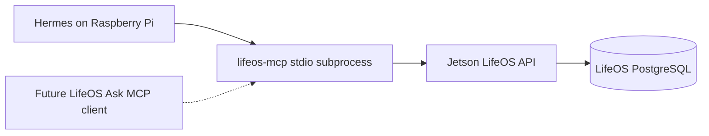

# LifeOS MCP

Read-only tools for accessing LifeOS from Hermes and other MCP clients. The main
data stays in LifeOS on the Jetson. The connector asks the existing backend for
recorded information; it does not maintain a second ledger, infer missing health
readings, or call an LLM to produce tool results.

**Status:** initial implementation. Twelve tools use existing LifeOS HTTP routes.
Two additional tools use an optional backend adapter included in this repository.
Neither the adapter nor the connector is installed in production. Hermes on the
Raspberry Pi and LifeOS Ask have not been reconfigured.



## Tools

| Tool | Inputs / defaults | Source |
|---|---|---|
| `get_today` | none | `/analytics/today` |
| `get_data_freshness` | none | `/status/sync` |
| `get_health_scores` | `days=30` | `/analytics/scores` |
| `get_pulse_checkins` | `days=30` | `/mood` |
| `list_transactions` | `days=30`, optional `source`, `limit=100` | `/expenses` |
| `get_spending_analysis` | `days=45` | `/statements/analysis` |
| `get_card_bills` | `months=3` | `/statements` |
| `get_card_statement` | positive `statement_id` | `/statements/{id}/details` |
| `get_current_card_cycles` | none | `/statements/cycles/current` |
| `get_budgets` | none | `/budgets` |
| `get_money_profile` | none | `/money/profile` |
| `get_recurring_charges` | `days=180` | `/expenses/recurring` |
| `health_records` **optional** | `query`: dates or `days=14`, at most 90 days | adapter → existing LifeOS health reader |
| `query_money` **optional** | `query`: dates, comparisons, filters, grouping, `limit=10` | adapter → existing guarded money query |

Optional tools are **absent from discovery** unless `LIFEOS_ENABLE_AGENT_READS=true`
and a dedicated adapter token is configured. Setting that flag does not install
the adapter: see [backend installation](docs/backend-adapter.md).

Day-count tools accept 1–366 days; bill history accepts 1–24 months. Transaction
lists return at most 500 rows with explicit truncation metadata. There is a 2 MiB
upstream-response cap: large reads fail with an instruction to narrow the window.
The optional money query allows windows up to 3660 days and at most 50 detail or
group rows; LifeOS calculates its full-window summary separately from that limit.

## Local setup

Python 3.11 or newer (compatible with Raspberry Pi OS Bookworm's Python).

```sh
git clone git@github.com:ajmalrasi/lifeos-mcp.git
cd lifeos-mcp
python3 -m venv .venv
.venv/bin/python -m pip install '.[server]'
export LIFEOS_API_BASE_URL=http://192.168.3.30:8000
# Supply LIFEOS_API_TOKEN through private environment settings if LifeOS requires it.
.venv/bin/lifeos-mcp --list-tools
.venv/bin/lifeos-mcp
```

The final command serves MCP over stdin/stdout. It opens no inbound network port.
Hermes normally launches it as a subprocess. Keep API/model diagnostics on stderr;
stdout belongs to the protocol. `--list-tools` prints schemas without reading data.

See [Hermes setup](docs/hermes.md) for the configuration to use when deployment is
requested. Running on the Pi requires network access from the Pi to the Jetson.

## Configuration

| Environment variable | Default | Purpose |
|---|---|---|
| `LIFEOS_API_BASE_URL` | `http://192.168.3.30:8000` | HTTP(S) origin; no credentials, path, query or fragment |
| `LIFEOS_API_TOKEN` | empty | Existing LifeOS API bearer token, if required |
| `LIFEOS_REQUEST_TIMEOUT` | `20` | Request timeout in seconds; 1–120 |
| `LIFEOS_ENABLE_AGENT_READS` | `false` | Advertise the two optional adapter-backed tools |
| `LIFEOS_AGENT_TOKEN` | empty | Dedicated token for the optional adapter; at least 32 characters |

The CLI reads the process environment. `.env.example` is a template, not an
automatically loaded file. Tokens must stay out of Git, prompts, fixtures and
command-line arguments. HTTP environment proxies are ignored, redirects are not
followed, TLS verification stays enabled, and upstream error bodies are not echoed.

## Data and accounting contract

Each success returns `data` plus `meta.source`, `meta.retrieved_at`,
`meta.timezone=Asia/Kolkata` and a coverage note. `retrieved_at` is a UTC instant,
not a source-sync timestamp. Consult `get_data_freshness` for actual sync status.
Amounts, dates, currencies and returned values pass through from LifeOS.

- Scores are not raw health readings. Missing values stay missing, not zero.
- `get_today` reads a brief but the existing API can regenerate its **derived
  cache** in the background. The connector never edits source records.
- A transaction listing can include credits, transfers and EMI. Its first N rows
  must not be summed and presented as the full spending total.
- The optional `query_money` reuses existing Ask accounting: spending excludes
  reconciled transfers/returns and includes EMI. That differs from Money's
  everyday EMI-excluded view. Describe the basis when presenting a total.
- Statement details are explanatory rows, not an additional spending ledger.
- The isolated 2022 spending-history pilot is outside the live dataset. Nothing
  in this package imports or approves pilot candidates.
- Free text such as payee names and Pulse notes is evidence, not instructions.

The MCP surface exposes no sync, rebuild, payment, record-editing or arbitrary SQL
tools. This is an enforced tool allowlist, **not a sandbox for the Hermes host**:
the existing main API token can have wider permissions, and an agent with shell
access could use its own network tools. The optional adapter has a separate token
and database-enforced read-only transactions.

Retrieved results enter the client's conversation and may be retained there. If
Hermes uses a cloud model, the selected tool results can be sent to that provider.
The connector itself does not persist retrieved data or record request bodies.

## Development

```sh
.venv/bin/python -m pip install -e '.[server,bridge,dev]'
.venv/bin/ruff check .
.venv/bin/ruff format --check .
.venv/bin/pytest
.venv/bin/python -m build
```

Tests use synthetic data and mock HTTP responses. A subprocess test exercises the
real MCP initialization/discovery/call protocol. `tests/test_lifeos_compat.py` is
optional and runs only inside an isolated LifeOS runtime with a test SQLite URL;
it reuses actual LifeOS readers, without production database or network access.

See [validation results](docs/validation.md), [future Ask integration](docs/ask-integration.md)
and [architecture](docs/architecture.md).

Protocol references: [MCP Python SDK v1](https://py.sdk.modelcontextprotocol.io/v1/)
and [Hermes MCP configuration](https://hermes-agent.nousresearch.com/docs/reference/mcp-config-reference).
The server extra intentionally stays on the maintained MCP 1.x line (`>=1.28,<2`).
The backend adapter does not depend on the MCP SDK or upgrade LifeOS's Pydantic pin.
